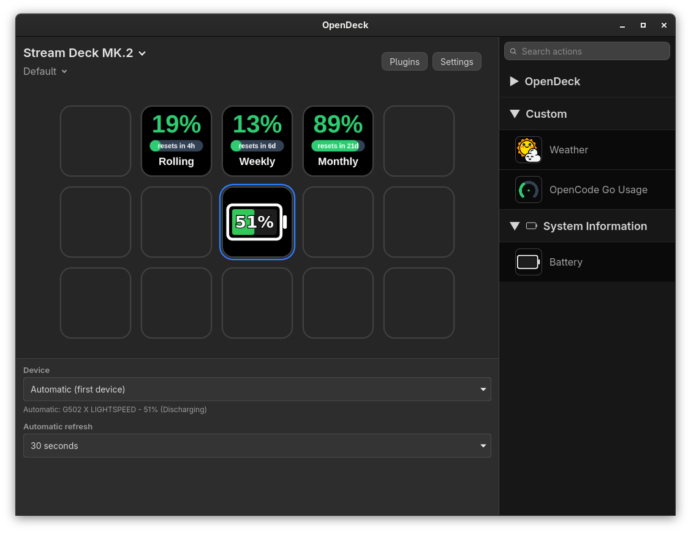

# OpenG

OpenDeck plugin that shows the battery level of a Logitech HID++ device on a key. The key is a battery icon filled to the current level, with the percentage inside. It turns red at 20% or below.



Linux only. Requires the `hid-logitech-hidpp` kernel driver (Unifying/Bolt receiver or Bluetooth).

## Settings

- **Device**: automatic (first available) or a specific device. The picker shows model name, battery level and charging status.
- **Automatic refresh**: 15 seconds to 15 minutes, or manual. In manual mode, press the key to refresh.

## Install

Download `dev.lyzev.openg.battery.streamDeckPlugin` from [releases](https://github.com/Lyzev/OpenG/releases) and install it from OpenDeck's Plugins page.

## Build

```sh
scripts/package.sh
```

`scripts/package.sh` builds and creates `dist/dev.lyzev.openg.battery.streamDeckPlugin`. It needs `zip`.

## Development

```sh
cargo fmt
cargo clippy --all-targets -- -D warnings
cargo test
node --check assets/pi/main.js
```

The release workflow runs on tags matching `v<version>`. `Cargo.toml` and `assets/manifest.json` must have the same version.

## Contributing

See [CONTRIBUTING.md](CONTRIBUTING.md).

## License

OpenG is free software under the [GNU Affero General Public License, version 3](LICENSE).
